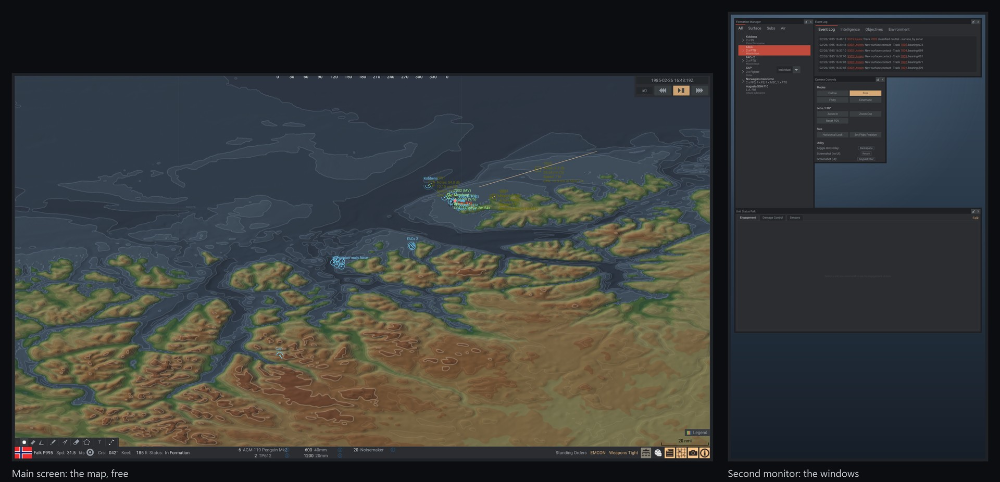
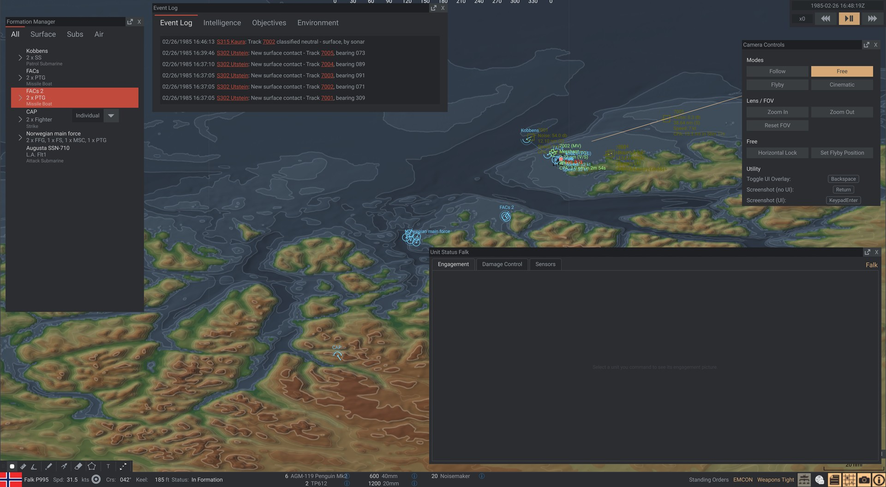
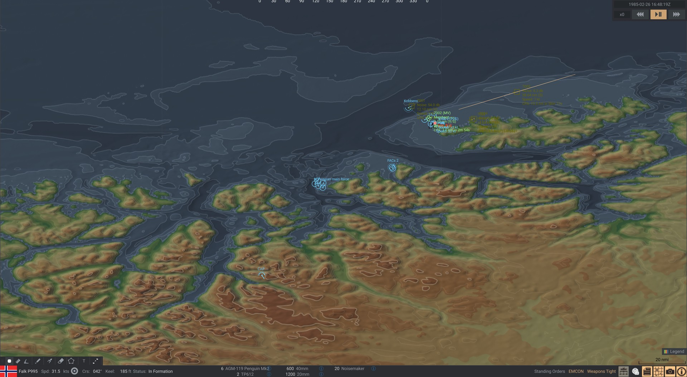
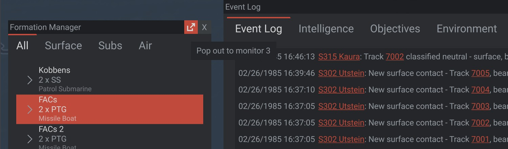
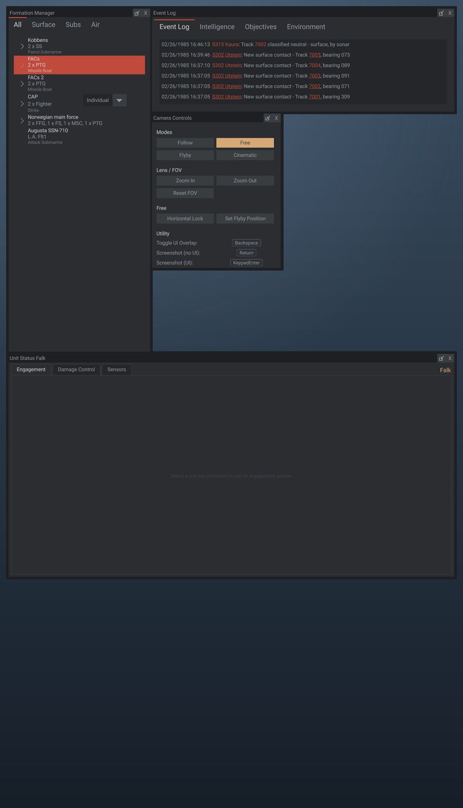

# Sea Power Pop-Out Windows

A mod for [Sea Power: Naval Combat in the Missile Age](https://store.steampowered.com/app/1286220/) that puts the
game's windows on another monitor, so the main screen stays free for the world view and the map.

**[Get it on the Steam Workshop](https://steamcommunity.com/sharedfiles/filedetails/?id=3826396311)** – requires
[Anchor Chain](https://steamcommunity.com/sharedfiles/filedetails/?id=3380210757).



- **Pop-out button** next to the X of every window – formation manager, message log, camera controls, unit status,
  sensor and doctrine windows – moves it to the other monitor; the same button there sends it back.
- **Free-floating windows**: only the popped-out windows show on that monitor, each with a thin frame that is its
  resize border. Around them your desktop and other programs show through and take the clicks.
- **Arrange them as you like**: pop out several, drag them around – a dragged window snaps to the others and to the
  monitor's edges. Over there a window can be made larger than the game normally allows.
- **Always in reach**: while you're in the game the popped-out windows stay above other programs on that monitor;
  switch to another program and they become normal windows again.
- **Remembered**: windows you popped out open on the other monitor in the next mission too, where you left them.
- **Wide resize corners** on every window, on both screens: the last stretch of each edge resizes diagonally (the
  game's own corner handle is a tiny square just outside the corner).
- It is the game's own window over there – same look, dragging, resizing and clicks. Clicks on the other monitor
  never reach the world or the map behind them, and the bottom-bar buttons keep working (they close and reopen the
  window over there). Right-clicking a unit in the formation manager opens its menu right there, on that monitor.
- **Formation manager tabs fixed** (a game bug, on both screens): with a category missing, e.g. no submarines, the
  "Air" tab really is Air – double-clicking a plane there no longer jumps the list to "All".

| | |
| --- | --- |
|  |  |
|  |  |

The map stays on the main screen – the game has its own options for putting the map or the world view on another
monitor. A monitor the game uses for those is skipped; the windows go to the first free one (and only float over
the game's view when there is none).

## Installation

1. Install **[Anchor Chain](https://steamcommunity.com/sharedfiles/filedetails/?id=3380210757)**, the Sea Power
   community mod loader, following its
   [installation guide](https://seapower-modders.github.io/AnchorChain/install-anchor-chain.html) (one manual step:
   copy its preloader into the game folder).
2. Subscribe to **[Sea Power: Rats Pop-Out Windows](https://steamcommunity.com/sharedfiles/filedetails/?id=3826396311)** on the Steam Workshop.
3. Connect the second monitor **before** starting the game. In a mission, click the new button left of the **X**
   in a window's title bar (a box with an arrow).

Manual install instead of the Workshop: put `SeaPowerPopOut.dll` and `_info.ini` into
`<Sea Power>\Sea Power_Data\StreamingAssets\SeaPowerPopOut\`.

Good to know: the first time a window pops out, the game takes over the other monitor (that is how Unity uses a
second display) and keeps it until it closes – with nothing popped out, nothing of the game shows there.

## Settings

`<Sea Power>\BepInEx\config\dev.sewerlabs.seapowerpopout.cfg` (created on the first start):

| Setting | What it does |
| --- | --- |
| Monitor | 0 = automatic (the first monitor the game doesn't use itself); 2 = the next monitor after the game's, 3 the one after – the log lists them with their resolutions |
| UI scale | Size of the windows on the other monitor, relative to the game's UI scale |
| Unlimited window size | Over there a window can be resized beyond the game's maximum, up to the whole monitor |
| See-through | Only the windows show on that monitor; off = the whole monitor turns dark while windows are popped out |
| Always on top | While you're in the game, the windows stay above other programs on that monitor |
| Snap windows | Dragged windows snap to each other and to the monitor's edges |
| Popped-out windows, Window placement | The remembered layout (written by the mod; clear it to bring every window back) |
| Wide resize corners | Diagonal resizing from the ends of every edge, on both screens |

## Compatibility

- Sea Power 0.8.x on Windows. The game updates often; if an update moves something the mod hooks into, the mod
  stays out of the way and the log says why – the game itself keeps running.
- Needs a second monitor. Works next to the game's own second-monitor map and detached world view (those monitors
  are skipped).
- Exclusive fullscreen: with a second monitor in use the world view can freeze (Unity; music and menus keep
  working). Use borderless windowed (Options > Graphics); the log warns when the game runs exclusive.
- No game files are changed. Uninstall by unsubscribing (or deleting the folder).
- Unticking the mod in the Mod Manager switches it off (after a restart): the mod reads the Mod Manager's choice
  itself, because Anchor Chain loads every mod folder regardless. Nothing the mod does survives a game restart
  except its config file; `Enable mod = false` there is a second switch.

Problems: `<Sea Power>\BepInEx\LogOutput.log` has a line for every step the mod takes (`[Info :SeaPowerPopOut]`);
please attach it to a bug report.

## Building from source

Requires the .NET SDK 8, Sea Power installed, and Anchor Chain subscribed (the build references the game's and
Anchor Chain's assemblies).

**Two game versions, one build.** Sea Power exists in 0.8.7 (flat map) and the 3D-globe build (the public beta of
26 October 2026). The windows and the Harmony targets this mod uses are the same in both: a DLL built against either
game has no reference that the other lacks (checked 2026-10-28 with `tools/compat-check` of the workspace: 1078 references,
0 missing on both games), so one DLL serves both, unlike the map mods, which ship one build per version.

```bash
dotnet build src/SeaPowerPopOut/SeaPowerPopOut.csproj -c Release -p:GameDir="C:\Program Files (x86)\Steam\steamapps\common\Sea Power"
```

The build copies the mod into `<Sea Power>\Sea Power_Data\StreamingAssets\SeaPowerPopOut\` (`-p:Deploy=false` to
skip). `GameDir` can also be set as an environment variable. Release packaging and the Workshop upload are described
in [docs/workshop.md](docs/workshop.md); in-game test checklists are in [docs/testing.md](docs/testing.md).

## How it works

The other monitor is a second NoesisView on another Unity display, built the way the game's own
`SecondDisplayMapHandler` builds its second-monitor map. Its root holds a second instance of the game's
`WindowHost` and a flat copy of the main game view's resources, so the window templates, dragging and resizing are
the game's own. Popping out moves a window's content object (its view model) from the main host's `Windows` to the
second host's. Harmony patches on `WindowHost` keep the bottom-bar toggles right, `Window.OnInitialized` adds the
title-bar button and restores the remembered placement, `MouseControlState.OnUpdate` treats the other monitor as UI
so clicks don't reach the world. Patches on the game's Noesis classes are applied only once NoesisGUI runs
(patching them at load runs their static constructors before Noesis is initialised, which crashes the game).

See-through: Unity shows an activated display in a borderless window covering the whole monitor. The mod finds
that window and cuts it down with `SetWindowRgn` to the popped-out windows, their resize frame and whatever
tooltip, context menu or drop-down list they have open, recomputed every frame after Noesis has laid out; the rest
of the monitor belongs to the desktop again. It is topmost (`SetWindowPos`) only while one of the game's windows
is in the foreground. A drag released over another program never reaches Unity, so a press whose button is
physically up (`GetAsyncKeyState`) gets its release sent to the view.

Unit menu: the game opens it from the context menu of a canvas of the main game view
(`MainGameView.ContextMenuCanvas`), looked up each time it opens. The pop-out screen has a copy of that menu on a
canvas of its own; a right-click there points the field at it until the next frame. A click on one monitor closes a
menu open on the other (each view only gets the clicks on its own monitor).

Formation manager tabs: the TabControl holds all six tabs, empty ones collapsed, so its `SelectedIndex` counts them
too, while the game's `FormationManagerViewModel.SelectedTabIndex` counts only the visible ones. A prefix on that
property's getter and setter counts every tab.

Pointer fix: `NoesisView` flips the mouse of another display with its camera's `pixelHeight`, which is not that
display's height when it differs from the game window's (or Windows scales it differently) – the pointer sits off by
the difference (400 px on a 2560 px portrait monitor next to a 2160 px game window): no resize cursor at the edges,
drags that jump, tooltips far from the cursor. A Harmony postfix on `NoesisView.MousePosition` corrects it for every
view on another monitor (the pop-out screen and the game's own second-monitor map / world view), reading the flip
height from the camera itself so the correction is zero where the game already gets it right. The log has one
`Pointer on monitor N` line with the numbers.

```
src/SeaPowerPopOut/
  Plugin.cs           entry point (Anchor Chain plugin)
  Patches.cs          every hook: WindowHost open/close, Window loaded, mouse over UI, NoesisView pointer,
                      mission start/end, formation manager tabs
  PopOutScreen.cs     the pop-out monitor (display, NoesisView, second WindowHost), title-bar buttons, moving
                      windows between the screens, unit menu, see-through cut-out, snapping, pointer fix
  MonitorWindow.cs    the Unity window of the pop-out display: found, cut to the windows, kept on top
  CornerResize.cs     wide resize corners on every game window
  FormationTabs.cs    the formation manager's tab index counted over every tab (game bug)
  Native.cs           the Win32 calls (window region, topmost, mouse button state)
  Layout.cs           remembered popped-out windows and their placement
  Settings.cs         config
  mod/_info.ini       Mod Manager entry
tools/package.ps1     release build → dist/SeaPowerPopOut/
tools/shot-director/  dev-only plugin and scripts that took the Workshop screenshots (docs/workshop.md)
workshop/             Workshop description, preview.jpg, screenshots/, release posts (promotion.md)
```

## License

[MIT](LICENSE). Not affiliated with Triassic Games or MicroProse. Nothing of the game is included in this repository
or in the mod.
