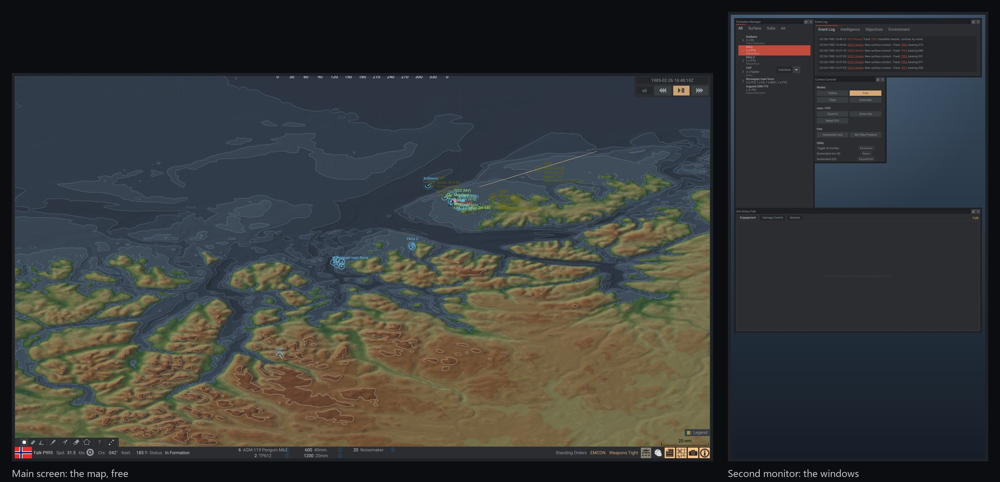
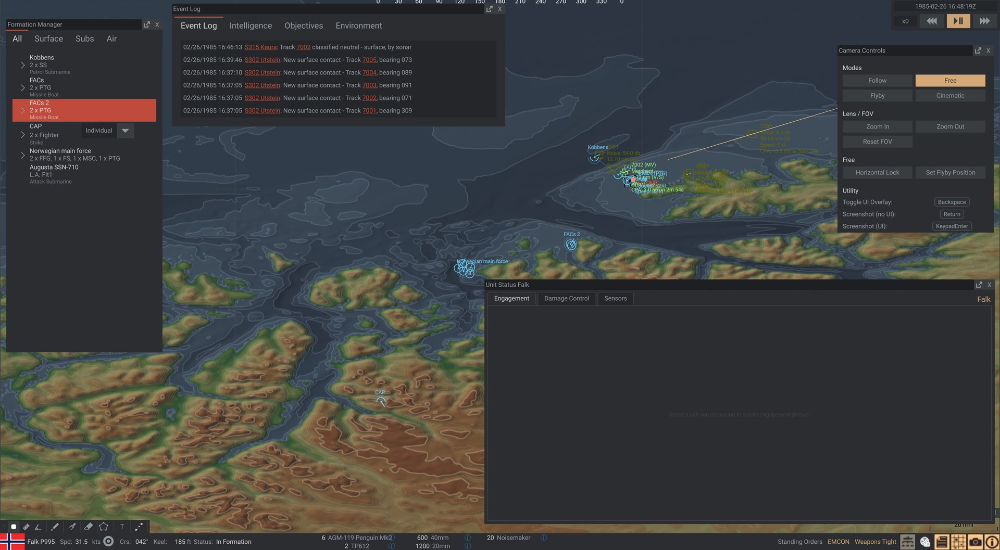
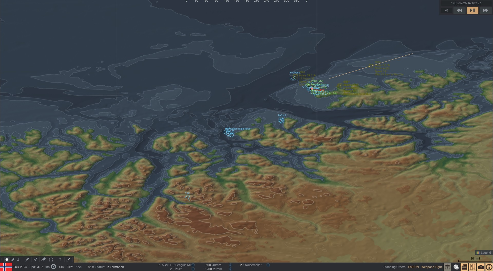
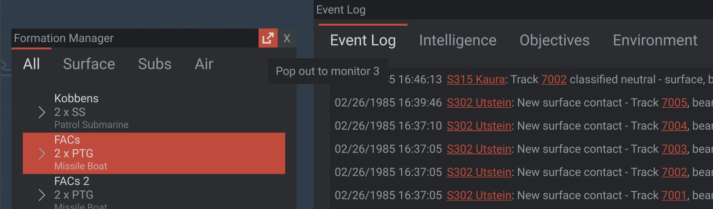
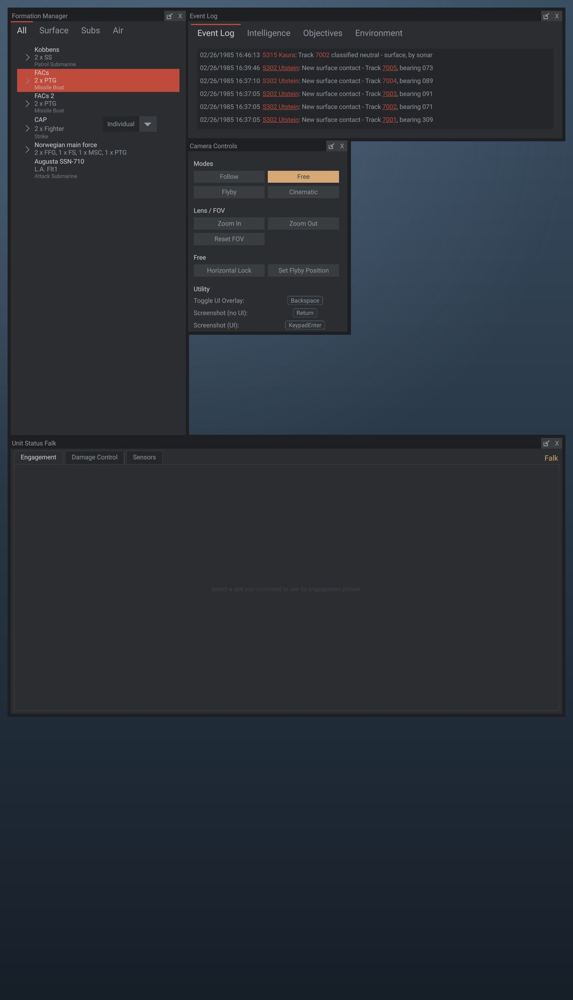
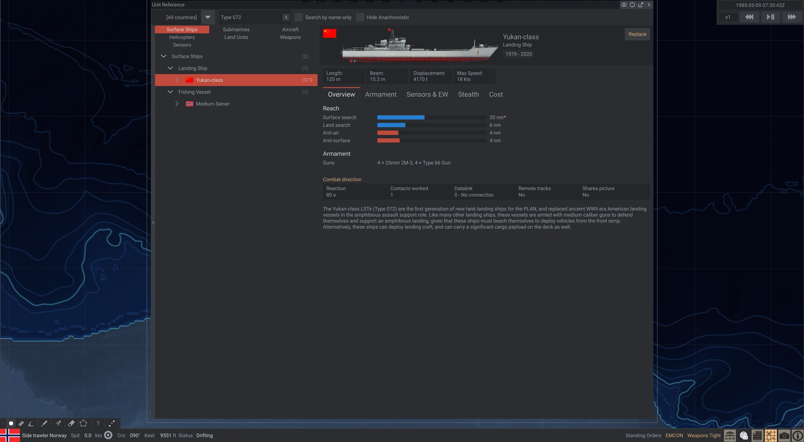
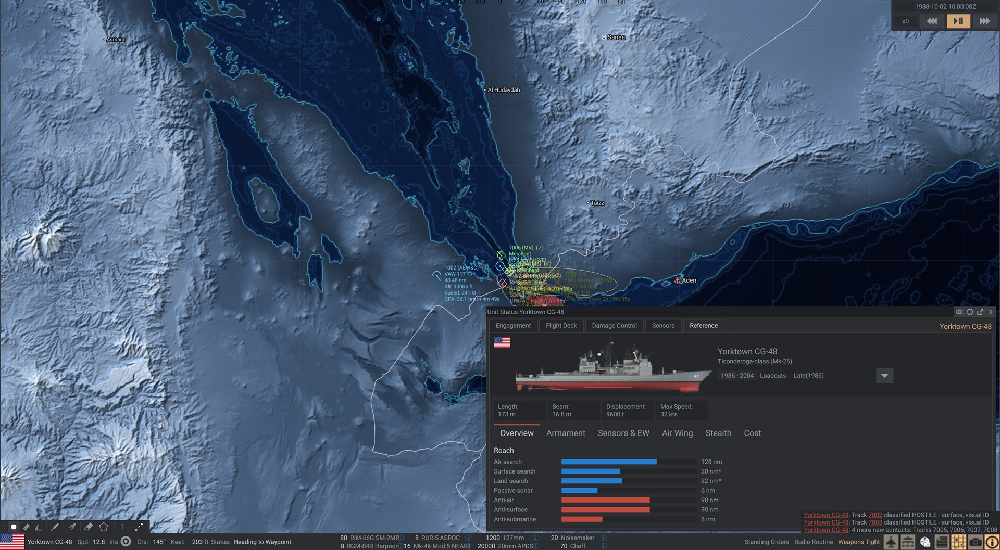

# Sea Power: R.A.T.S. Pop-Out Windows

Puts the game's windows on a second monitor, so the main screen stays free for the world view and the map.
It also adds window handling on the main screen: remembered places, snapping and a better Unit Reference.

Needs a mod loader, either one: [R.A.T.S. Keel](https://steamcommunity.com/sharedfiles/filedetails/?id=3835527459) or [Anchor Chain](https://steamcommunity.com/sharedfiles/filedetails/?id=3380210757).

- [Steam Workshop](https://steamcommunity.com/sharedfiles/filedetails/?id=3826396311)
- [R.A.T.S. feedback board](https://hub.sewerlabs.dev/s/popout)



## What it does

### Pop-out monitor

- A pop-out mark in the title bar, left of the X, opens a menu with "Pop out to monitor" and "Back to the main screen".
- It works for the formation manager, message log, camera controls, unit status, sensor and doctrine windows.
- Windows of other authors' mods keep their own title bar, without the pop-out menu.
- Only the popped-out windows show on that monitor, each with a thin frame that is its resize border.
  - The desktop and other programs show through around them and take the clicks.
  - "See-through" off turns the whole monitor dark instead.
- Windows snap to each other and to the monitor's edges. Hold Shift to move one freely.
- A window can be resized beyond the game's maximum, up to the whole monitor.
- While you are in the game the windows stay above other programs on that monitor.
- Windows you popped out open there again in the next mission, in the same place.
- Clicks on the other monitor do not reach the world or the map behind them.
- A right-click on a unit in the formation manager opens its menu on that monitor.
- The monitor is the first one the game does not use itself. The game's own second-monitor map and world view monitors are skipped.
  With no free monitor, the windows float over the game's view.

| Before: the windows cover the map | After: the same map, free |
| --- | --- |
|  |  |
|  |  |

### All windows, both screens

- Wide resize corners: the last stretch of each edge resizes diagonally.
- Fixed game bug: with a category missing in the formation manager (no submarines, say), the "Air" tab really is Air.

### Smart Windows features

Based on rgreat's [Smart Windows](https://steamcommunity.com/sharedfiles/filedetails/?id=3813683442), rewritten in the `SmartWindows/` folder. Thanks to rgreat for the original.

- Windows in general
  - A thin frame on the visible edge (left, right, bottom).
  - A double-click on the title bar maximizes or restores the window.
  - A click raises the window.
  - Snapping to the screen edges and to other windows.
  - A gear button opens a settings panel in the game's nine languages (`lang/*.ini`).
  - A look button sets opacity, scale, text outline and level (below or above the other windows).
  - All of this also works on popped-out windows.
- Remembered windows
  - Position, size and maximized state come back in the next mission.
  - The list of windows is a setting (`Window patterns`); it covers Tactical Display, Unit Reference, Unit Status, Event Log and more.
- Unit Reference (Encyclopedia)
  - A splitter with a remembered tree width; hiding the tree narrows the window.
  - Classes are sorted by service date; loadout variants are labelled like "Long-Hull [Early]".
  - A click on a class picks its earliest variant.
  - The search also finds ids and description text.
  - The country list shows only countries that have units.
  - "Armed only" leaves out units without weapons.
  - The wheel scrolls the tree only over it, and the tree scrolls to the selected unit.
  - Country, category, filters and search text are kept between runs.
  - Link tooltips show the short help of a weapon, sensor or system.
  - The unit the window was opened for stays in the tree even when a filter would hide it.
  - The loadout selector also shows for ships, submarines and land units.
- Unit Status
  - The header shows the full unit name.
  - A Reference tab shows the Unit Reference page of the unit.
  - A Track tab shows the Track State of a selected contact.
  - Damage Control sections can be taller.
- Mission
  - A right-click on the flag or name in the unit panel opens the unit's menu.
  - The time panel can be dragged; a double-click puts it back.
  - Optional: the corner messages stop blocking clicks (their unit links then stop working too).
- Campaign Task Force Builder
  - Loadouts are listed oldest first.
  - A "Strict loadouts" check box on the campaign start screen.
  - Damaged ships can be dismissed.
  - The price of a hull swap is fixed.
  - Optional "Upgrade ship" button.
- Menus
  - "_Custom Mission" is left out of SCENARIOS.
  - The mission editor's file picker starts in the last folder and colours `.ini` files.
  - Optional: mod-only backgrounds, and deleting old game logs.
- Desktop mode (off by default)
  - The game's minimap key switches between 2 to 5 desktops of window layouts.
  - With the game's World View on another monitor, the map keeps the whole screen and the desktops arrange the windows over it.
  - Without that, the 3D world becomes a window of its own (World View) next to the map window.




## Install

1. Install a mod loader, either one.
   - R.A.T.S. Keel: subscribe, switch it on in the Mods menu, copy its one stub file once.
   - Anchor Chain: follow its [installation guide](https://seapower-modders.github.io/AnchorChain/install-anchor-chain.html).
2. Subscribe to [R.A.T.S. Pop-Out Windows](https://steamcommunity.com/sharedfiles/filedetails/?id=3826396311) on the Workshop.
3. Connect the second monitor before you start the game.
4. In a mission, click the pop-out mark left of the X in a window's title bar and choose "Pop out to monitor".

Manual install: put `SeaPowerPopOut.dll` and `_info.ini` into `<Sea Power>\Sea Power_Data\StreamingAssets\SeaPowerPopOut\`.

The first time a window pops out, the game takes over the other monitor and keeps it until it closes. With nothing popped out, nothing of the game shows there.

## Settings

The mod has two config files in `<Sea Power>\BepInEx\config\`. Both are created on the first start. Many settings say "needs a restart".

- `dev.sewerlabs.seapowerpopout.cfg`: the pop-out monitor and the mod itself.
- `dev.sewerlabs.seapowerpopout.smartwindows.cfg`: the Smart Windows features. Most of them are also in the settings panel (gear button).

### Pop-out monitor

| Section | Setting | Default | What it does |
| --- | --- | --- | --- |
| 1. General | Enable mod | on | Master switch for the whole mod |
| 1. General | Verbose log | off | More lines in `LogOutput.log` |
| 2. Pop-out screen | Monitor | 0 | 0 = first monitor the game does not use itself; 2 = the next one after the game's, 3 the one after that. The log lists them. |
| 2. Pop-out screen | UI scale | 1.0 | Size of the windows there, relative to the game's UI scale |
| 2. Pop-out screen | Unlimited window size | on | Resize beyond the game's maximum |
| 2. Pop-out screen | See-through | on | Only the windows show; off = the whole monitor turns dark |
| 2. Pop-out screen | Always on top | on | Windows stay above other programs while you are in the game |
| 2. Pop-out screen | Snap windows | on | Snapping on the pop-out monitor |
| 3. Remembered layout | Popped-out windows, Window placement | empty | Written by the mod; clear "Popped-out windows" to bring every window back |
| 4. All windows | Wide resize corners | on | Diagonal resizing from the ends of every edge, on both screens |

### Smart Windows: master switch and feature switches

"Enable window memory" (`1. General`, default on, needs a restart) is the master switch: off, no Smart Windows feature starts.
Every feature below also has its own switch.

| Feature | Setting | Default |
| --- | --- | --- |
| Remembered window places (desktop mode needs it too) | 2. Remembered windows > Remember window places | on |
| Click raises a window, double-click maximizes | 3. Placement > Window clicks | on |
| Snapping on the main screen (distance: `Snap distance`, 6 px) | 3. Placement > Snap windows | on |
| Frame around windows | 4. Window border > Enabled | on |
| Frame around tooltips (needs the frame on) | 4. Window border > Tooltip frame | on |
| Gear button for the settings panel | 5. Settings window > Gear button | on |
| Window looks | 5. Settings window > Apply window looks | on |
| Look button (shown with the looks) | 5. Settings window > Look button | on |
| Unit Reference: remember choices | 6. Unit Reference > Remember choices | on |
| Unit Reference: splitter and layout | 6. Unit Reference > Improved layout | on |
| Unit Reference: earliest variant on click | 6. Unit Reference > Earliest variant on click | on |
| Unit Reference: scroll to selected | 6. Unit Reference > Scroll to selected | on |
| Unit Reference: wheel only over the tree | 6. Unit Reference > Wheel only over the tree | on |
| Unit Reference: only countries with units | 6. Unit Reference > Only countries with units | on |
| Unit Reference: armed only | 6. Unit Reference > Armed only | off |
| Unit Reference: loadout list for all units | 6. Unit Reference > Loadout list for all units | on |
| Unit Reference: sort tree by date | 6. Unit Reference > Sort tree by date | on |
| Unit Reference: group loadout variants | 6. Unit Reference > Group loadout variants | on |
| Unit Reference: search ids and descriptions | 6. Unit Reference > Search ids and descriptions | on |
| Unit Reference: link tooltips | 6. Unit Reference > Link tooltips | on |
| Unit Reference: keep the opened unit | 6. Unit Reference > Keep the opened unit | on |
| Unit Status: full unit name | 7. Unit Status > Full unit name | on |
| Unit Status: Reference tab | 7. Unit Status > Reference tab | on |
| Unit Status: Damage Control section height (0 = the game's) | 7. Unit Status > Sections min height | 278 |
| Unit Status: Track tab | 7. Unit Status > Track State | on |
| Unit panel menu | 8. Housekeeping > Unit panel menu | on |
| Messages do not block clicks | 8. Housekeeping > Messages do not block clicks | off |
| Resize cursors outside missions | 8. Housekeeping > Resize cursors in menus | on |
| Mod backgrounds only | 8. Housekeeping > Mod backgrounds only | off |
| Hide "_Custom Mission" | 8. Housekeeping > Hide _Custom Mission | on |
| Remember mission folder | 8. Housekeeping > Remember mission folder | on |
| Colour `.ini` files (colour: `Ini file color`) | 8. Housekeeping > Color ini files | on |
| Delete old game logs | 8. Housekeeping > Delete old game logs | off |
| Campaign: dismiss damaged ships | A. Campaign > Dismiss damaged ships | on |
| Campaign: fix hull swap price | A. Campaign > Fix hull swap price | on |
| Campaign: "Upgrade ship" button | A. Campaign > Upgrade ship | off |
| Campaign: strict loadouts | A. Campaign > Strict loadouts | on |
| Campaign: sort loadouts by date | A. Campaign > Sort loadouts by date | on |
| Campaign: loadout panel order | A. Campaign > Loadout panel order | on |
| Desktop mode | B. Desktop mode > Enabled | off |
| Draggable time panel | B. Mission > Draggable time panel | on |

Other Smart Windows settings:

- `1. General > Language`: a game language code (en, ru, cn, de, es, fr, ko, ja, vn); empty = the game's own.
- `2. Remembered windows > Window patterns`: which windows are remembered.
- `3. Placement`: `Cascade offset`, `Allow dragging outside`, `Minimum visible pixels`.
- `4. Window border`: `Thickness`, `Color`.
- `B. Desktop mode`: `Desktops` (2 to 5) and `World View key` (no key by default).
- Sections 9 and the "Written by the mod" entries of 6, 8 and B hold what the mod saves itself.

## Compatibility

- `_info.ini` declares Sea Power 0.8.7 up to every 0.9.x.
- One DLL serves the flat 0.8.7 map and the 3D-globe builds: `modtool compat` finds no reference that one game has and the other lacks.
- Run in the game: 0.8.7 (Smart Windows, desktop mode) and the globe builds (pop-out, formation manager menu; latest 0.9.1, build 261112, on 12 November 2026, under Keel).
  See `CHANGELOG.md` for what each run covered.
- Both loaders: it uses the Anchor Chain entry point, which Keel runs as well. Under Anchor Chain it was run on 0.8.7 only; Anchor Chain does not start on the globe builds yet.
- Needs a second monitor for the pop-out part. The Smart Windows features work without one.
- Exclusive fullscreen: with a second monitor in use, the world view can freeze. Use borderless windowed (Options > Graphics); the log warns when the game runs exclusive.
- No game files are changed. Uninstall by unsubscribing or deleting the folder.
- Unticking the mod in the Mod Manager switches it off after a restart. `Enable mod = false` is a second switch.

## Feedback

Bugs, ideas and questions go on the [R.A.T.S. feedback board](https://hub.sewerlabs.dev/s/popout).
For a bug, add `<Sea Power>\BepInEx\LogOutput.log`; every step of the mod has a line there (`[Info :SeaPowerPopOut]`).

## Building

- Needs the .NET SDK 8 and Sea Power installed (the build references the game's assemblies).
- Needs the Keel repo next to this one: the shared skeleton (entry point, host, log, settings, hook registry) is `SeaPowerKeel\shared`.
  It is found through the workspace folder that holds `mods.json`; for a clone elsewhere use `-p:RatsWorkspace=<folder>`.
- Anchor Chain's library comes from Keel's copy.

```bash
dotnet build src/SeaPowerPopOut/SeaPowerPopOut.csproj -c Release -p:GameDir="C:\Program Files (x86)\Steam\steamapps\common\Sea Power"
```

- The build copies the mod into `<Sea Power>\Sea Power_Data\StreamingAssets\SeaPowerPopOut\`; `-p:Deploy=false` skips that.
- `GameDir` can also be an environment variable.
- Packaging and the Workshop upload: [docs/workshop.md](docs/workshop.md). In-game checklists: [docs/testing.md](docs/testing.md).

### How it works

- The other monitor is a second NoesisView on another Unity display, built like the game's own `SecondDisplayMapHandler` builds its map.
  - Its root holds a second `WindowHost` and a flat copy of the main view's resources, so templates, dragging and resizing are the game's own.
  - Popping out moves a window's view model from the main host's `Windows` to the second host's.
- Patches on the game's Noesis classes go in only once NoesisGUI runs; patching earlier runs their static constructors before Noesis is set up and crashes the game.
- See-through: Unity shows an activated display in a borderless window over the whole monitor.
  - The mod cuts it down with `SetWindowRgn` to the popped-out windows, their resize frame and any open tooltip, menu or drop-down list, every frame.
  - It is topmost only while one of the game's windows is in the foreground.
  - A drag released over another program never reaches Unity, so a press whose button is up (`GetAsyncKeyState`) gets its release sent to the view.
- Unit menu: the pop-out screen has its own copy of the game's unit menu canvas; a right-click there points the game's field at it until the next frame.
- Templates: a window remembered as popped out opens the screen before other mods add their window templates, so new resources are copied over each time a window opens there or pops out.
- Formation manager tabs: the TabControl holds six tabs with empty ones collapsed, while `SelectedIndex` of the view model counts only visible ones. A prefix on its getter and setter counts every tab.
- Pointer fix: `NoesisView` flips the mouse of another display with its camera's `pixelHeight`, which differs from the display's height in some setups, so the pointer sat off by the difference (400 px on a 2560 px portrait monitor).
  A postfix on `NoesisView.MousePosition` corrects it for every view on another monitor. The log has one `Pointer on monitor N` line.

### Layout

```
src/SeaPowerPopOut/
  Plugin.cs           entry point (the shared ModEntry starts it)
  ModInfo.cs          what the shared skeleton reads: GUID, name, version, log source
  Patches.cs          every hook, declared in the shared HookRegistry
  PopOutScreen.cs     the pop-out monitor, title-bar buttons, moving windows between screens; the mod's host
  ScreenCutOut.cs     what of the see-through monitor stays visible
  UnitMenuCopy.cs     the game's unit menu on the pop-out monitor
  ScreenResources.cs  the pop-out screen's copy of the main view's resources
  PointerFix.cs       the pointer of views on other monitors
  GameMouse.cs        the game's mouse state, shared with Smart Windows
  MonitorWindow.cs    the Unity window of the pop-out display: found, cut, kept on top
  CornerResize.cs     wide resize corners
  FormationTabs.cs    formation manager tab index over every tab
  Native.cs           the Win32 calls
  Layout.cs           remembered popped-out windows and their placement
  Settings.cs         config
  SmartWindows/       the Smart Windows features: each declares its switch, hooks and handlers (Feature.cs);
                      SmartFeatures.cs runs them in order; SnapController.cs snaps on both screens
  mod/                _info.ini and lang/*.ini
tools/package.ps1     release build -> dist/SeaPowerPopOut/
tools/shot-director/  dev-only plugin and scripts that took the Workshop screenshots
workshop/             Workshop description, preview.jpg, screenshots/
```

## Licenses and credits

- [R.A.T.S. Source License](LICENSE): read it, fork it, send fixes; no re-uploads, no reuse in other projects.
- Window handling is based on rgreat's Smart Windows (link above).
- Not affiliated with Triassic Games or MicroProse. Nothing of the game is included in this repository or in the mod.
