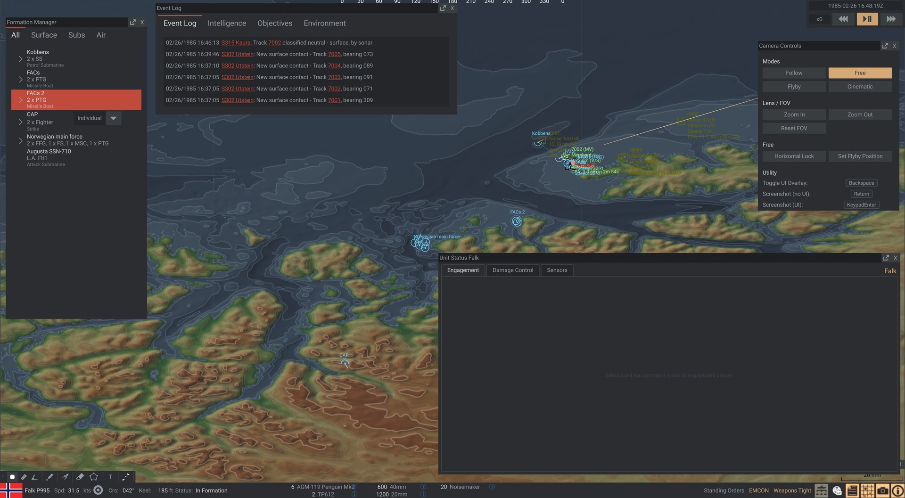
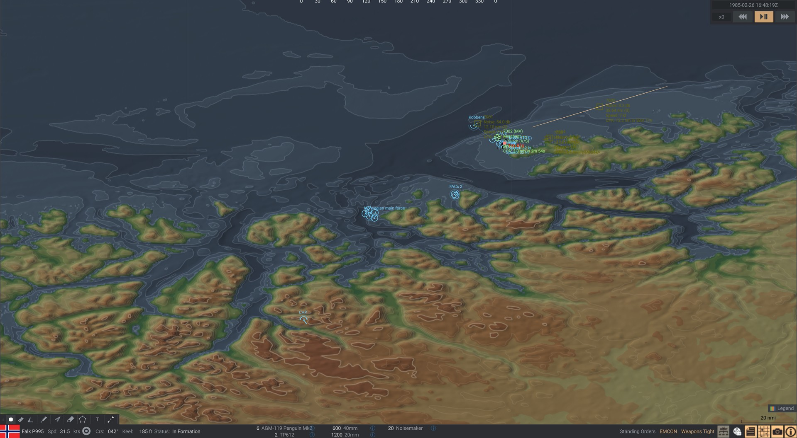
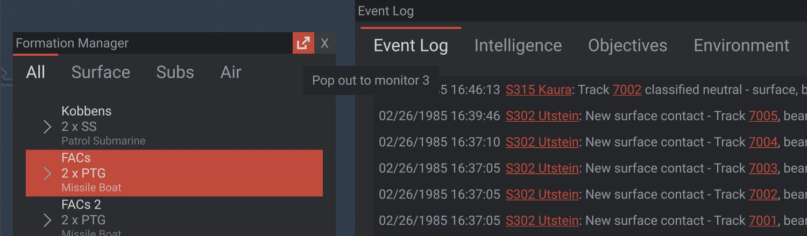
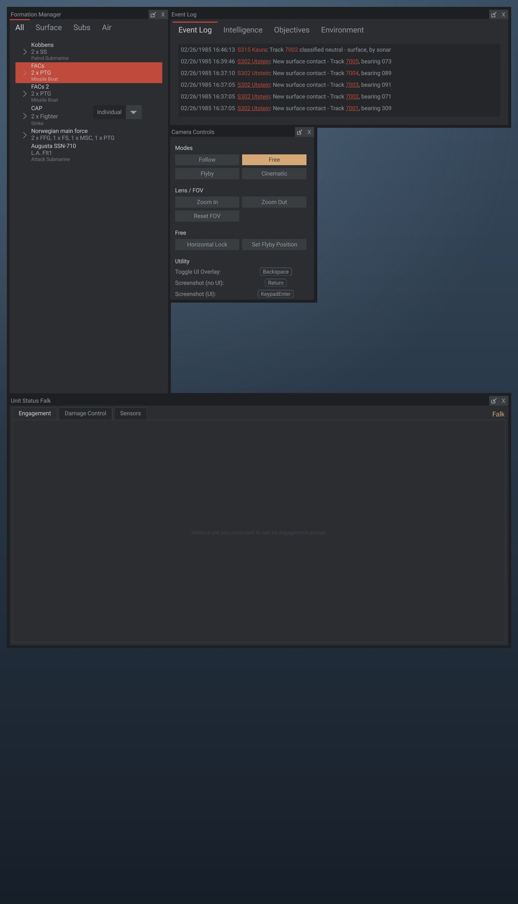
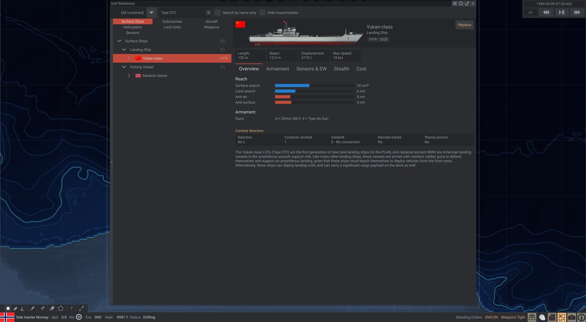
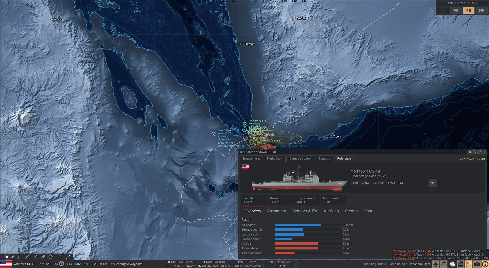

# R.A.T.S. Pop-Out Windows: feature detail

Everything the mod does, in full. The short list is in the [README](../README.md).

## Pop-out monitor

- A pop-out mark in the title bar, left of the X, opens a menu with "Pop out to monitor" and "Back to the main screen".
- It works for the formation manager, message log, camera controls, unit status, sensor and doctrine windows.
- Windows of other authors' mods keep their own title bar, without the pop-out menu.
- Only the popped-out windows show on that monitor, each with a thin frame that is its resize border.
  - The desktop and other programs show through around them and take the clicks.
  - "See-through" off turns the whole monitor dark instead.
- Windows snap to each other and to the monitor's edges. Hold Shift to move one freely.
- A window can be resized beyond the game's maximum, up to the whole monitor.
- While you are in the game the windows stay above other programs on that monitor.
- Windows you popped out open there again in the next mission, in the same place.
- Clicks on the other monitor do not reach the world or the map behind them.
- A right-click on a unit in the formation manager opens its menu on that monitor.
- The monitor is the first one the game does not use itself. The game's own second-monitor map and world view monitors are skipped.
  With no free monitor, the windows float over the game's view.

| Before: the windows cover the map | After: the same map, free |
| --- | --- |
|  |  |
|  |  |

## All windows, both screens

- Wide resize corners: the last stretch of each edge resizes diagonally.
- Fixed game bug: with a category missing in the formation manager (no submarines, say), the "Air" tab really is Air.

## Smart Windows features

Based on rgreat's [Smart Windows](https://steamcommunity.com/sharedfiles/filedetails/?id=3813683442), rewritten in the `SmartWindows/` folder. Thanks to rgreat for the original.

- Windows in general
  - A thin frame on the visible edge (left, right, bottom).
  - A double-click on the title bar maximizes or restores the window.
  - A click raises the window.
  - Snapping to the screen edges and to other windows.
  - A gear button opens a settings panel in the game's nine languages (`lang/*.ini`).
  - A look button sets opacity, scale, text outline and level (below or above the other windows).
  - All of this also works on popped-out windows.
- Remembered windows
  - Position, size and maximized state come back in the next mission.
  - The list of windows is a setting (`Window patterns`); it covers Tactical Display, Unit Reference, Unit Status, Event Log and more.
- Unit Reference (Encyclopedia)
  - A splitter with a remembered tree width; hiding the tree narrows the window.
  - Classes are sorted by service date; loadout variants are labelled like "Long-Hull [Early]".
  - A click on a class picks its earliest variant.
  - The search also finds ids and description text.
  - The country list shows only countries that have units.
  - "Armed only" leaves out units without weapons.
  - The wheel scrolls the tree only over it, and the tree scrolls to the selected unit.
  - Country, category, filters and search text are kept between runs.
  - Link tooltips show the short help of a weapon, sensor or system.
  - The unit the window was opened for stays in the tree even when a filter would hide it.
  - The loadout selector also shows for ships, submarines and land units.
- Unit Status
  - The header shows the full unit name.
  - A Reference tab shows the Unit Reference page of the unit.
  - A Track tab shows the Track State of a selected contact.
  - Damage Control sections can be taller.
- Mission
  - A right-click on the flag or name in the unit panel opens the unit's menu.
  - The time panel can be dragged; a double-click puts it back.
  - Optional: the corner messages stop blocking clicks (their unit links then stop working too).
- Campaign Task Force Builder
  - Loadouts are listed oldest first.
  - A "Strict loadouts" check box on the campaign start screen.
  - Damaged ships can be dismissed.
  - The price of a hull swap is fixed.
  - Optional "Upgrade ship" button.
- Menus
  - "_Custom Mission" is left out of SCENARIOS.
  - The mission editor's file picker starts in the last folder and colours `.ini` files.
  - Optional: mod-only backgrounds, and deleting old game logs.
- Desktop mode (off by default)
  - The game's minimap key switches between 2 to 5 desktops of window layouts.
  - With the game's World View on another monitor, the map keeps the whole screen and the desktops arrange the windows over it.
  - Without that, the 3D world becomes a window of its own (World View) next to the map window.

## Compatibility

- `_info.ini` declares Sea Power 0.8.7 up to every 0.9.x.
- One DLL serves the flat 0.8.7 map and the 3D-globe builds: `modtool compat` finds no reference that one game has and the other lacks.
- Run in the game: 0.8.7 (Smart Windows, desktop mode) and the globe builds (pop-out, formation manager menu; latest 0.9.1, build 261112, on 12 November 2026, under Keel).
  See `CHANGELOG.md` for what each run covered.
- Loader: R.A.T.S. Keel. It uses the Anchor Chain entry point, which Keel carries on.
- Needs a second monitor for the pop-out part. The Smart Windows features work without one.
- Exclusive fullscreen: with a second monitor in use, the world view can freeze. Use borderless windowed (Options > Graphics); the log warns when the game runs exclusive.
- No game files are changed. Uninstall by unsubscribing or deleting the folder.
- Unticking the mod in the Mod Manager switches it off after a restart. `Enable mod = false` is a second switch.
